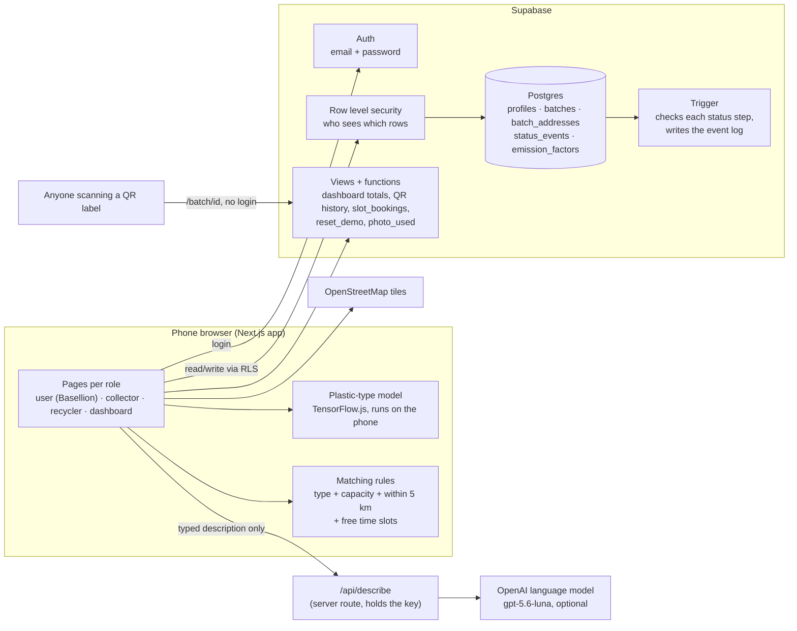

# Circular Plastics Exchange

LYB Mumbai Hackathon 2026, Problem Statement 1.

A mobile-first web app that connects households, societies, campuses and small businesses with collectors and recyclers. Users "feed" Basellion, a recycling monster: they photograph the item, the AI reads the plastic type, and Basellion eats recyclable plastic or spits out what can't be recycled. The user then books a nearby collector (within 5 km) for a time slot the collector confirms, follows the pickup like a parcel (requested → confirmed → on the way → picked up), and earns coins. A QR label carries the chain of custody all the way to the recycler.

In the database the user role is called `generator`, as in the problem statement. On screen it is just "User".

All data is fictional. Plant X, every society, collector, recycler, area and address is made up.

## What it does

| Problem statement asks for | Where it is |
|---|---|
| Separate logins for generators, collectors, recyclers | 4 roles (User, Collector, Recycler, Plant X), one demo login each. The database rules decide what each role sees. |
| Photo → plastic type with a confidence score | `/user/new` ("Feed Basellion"): our own model, running in the browser |
| Match listing to collector/recycler by type, quantity, location | Collectors within 5 km that take the plastic and have room, nearest first, with the reason, e.g. "Accepts PET · 0.5 km · capacity 80 kg" |
| Schedule pickups, track every status | The user picks a 2-hour slot and the collector confirms or declines it. Parcel-style tracker: Listed → Pickup requested → Pickup confirmed → Collector on the way → Picked up → At the recycler → Recycled. Every step goes into an append-only log. |
| Impact dashboard: kg by type and area, CO₂ avoided | `/dashboard`. A headline strip shows CO₂ avoided and plastic recycled, per day and so far, "as on" today's date with Indian digit grouping. It follows the style of government impact counters such as the [PM E-DRIVE dashboard](https://pmedrive.heavyindustries.gov.in/dashboard-home) ("CO2 Reduction per day (In Kg.)", data as per Vahan). The formula and assumptions are shown below the strip, and each user sees their own CO₂ avoided on their home screen. |
| Bonus: points for generators | 10 coins per kg, given in full at pickup, plus a society leaderboard |
| Bonus: QR label per batch | QR on every batch → public history page with no names |

Extras:
- Sign-up for new users (name, phone, age, gender, first address) and a Profile page to edit details and keep several pickup addresses. You choose the address for each pickup, and the 5 km collector search starts from it.
- 1 to 3 photos per listing, from the in-app camera or the device. Items are found automatically, boxed and numbered 1, 2, 3 from left to right, and each one is classified on its own crop:
  1. items laid out on a plain floor or sheet are found by comparing them with the background (`lib/objects.ts`);
  2. on a busy background, a ready-made object detector (COCO-SSD, `lib/detect.ts`) finds everyday objects such as bottles, cups and bowls, and skips people, hands, tables, chairs and other background;
  3. otherwise the whole photo is one item. If only a hand or person was found, the app suggests putting the item down on a plain surface.
- When the AI can't identify an item (below 60%), a "What is it?" box appears next to its number, followed by a category picker. Typing a name suggests the usual plastic ("Dark Fantasy wrapper" or "black tiffin" → PP, "milk pouch" → LDPE). Every item also has "Not right? Tell us what it is" for when the AI is confidently wrong.
- **Ask Basellion** (optional): describe the waste in words, e.g. "a whole packet of Dark Fantasy cookies". A language model (OpenAI) lists the pieces with type, count and approximate grams, e.g. 1 outer pack, 1 tray and 6 cookie wrappers, all PP, marked "typical, check the pack". One tap adds them as numbered items the user can still edit, and the grams give a weight estimate.
- Clear category descriptions and a "How to tell the plastics apart" guide: the printed code always wins; crinkly film that springs back is usually PP, soft stretchy film is usually LDPE.
- One pickup can hold several plastics (e.g. PET + PP); only collectors who take all of them are offered. Each numbered item is saved with its name, the AI's guess and the chosen type.
- **Send for recycling** sits under Basellion, with a line saying what is still missing.
- Basellion the monster: happy when fed in the last 7 days, hungry after 7, a grey wilting monster with a dead twig after 14. It eats recyclable plastic and spits out the rest. Tap it to preview its moods.
- Sorting tips for each plastic type
- A "check at pickup" flag when the AI is unsure
- A reused-photo check
- A weight-mismatch flag (more than 20% off)
- Grade A/B/C with an estimated ₹ value
- A simple collector screen in Hindi and Marathi
- A Plant X feedstock forecast
- A one-click demo reset

## Architecture



The photo never leaves the phone. Only the model's answer and an 8×8 image fingerprint (for the reused-photo check) are saved.

## Run it locally

Needs Node 24 and Docker Desktop (for the local database).

```bash
npm install
npx supabase start      # first run downloads the database images
npm run reset-db        # creates tables + loads the demo data
npm run dev             # http://localhost:3000
```

Copy `.env.example` to `.env.local` and fill in the values `npx supabase status` prints:

```
NEXT_PUBLIC_SUPABASE_URL=http://127.0.0.1:44321
NEXT_PUBLIC_SUPABASE_ANON_KEY=<publishable key>
OPENAI_API_KEY=<your key>          # optional, turns on "Ask Basellion"
# OPENAI_MODEL=gpt-5.6-luna        # optional, OpenAI's low-cost model is the default
```

The OpenAI key is read only by the server route `app/api/describe/route.ts`. It is never sent to the browser, and `.env.local` is git-ignored. Without a key the app still works; the chat just says it isn't set up. On Vercel, add the key under Project → Settings → Environment Variables.

The local ports are 443xx instead of Supabase's usual 543xx. On some Windows laptops, Hyper-V reserves the 54xxx range and the database refuses to start.

**Camera on a real phone:** browsers only open the in-app camera on `https://` or `localhost`. On a phone, use the deployed (https) site, or run `npx next dev --experimental-https -H 0.0.0.0` and accept the certificate warning. "Upload from device" works everywhere.

**Opening the QR label on a real phone:** the QR code holds the address of the page you are on. `localhost` won't open on a phone, so either deploy (below) or run `npm run dev -- -H 0.0.0.0`. Then open the app on the laptop at `http://<laptop-ip>:3000` with the phone on the same Wi-Fi.

**Deploying (untested so far):** create a free project on supabase.com. In its SQL editor, run `supabase/migrations/20261112000000_schema.sql` and then `supabase/seed.sql`. Under Authentication → Sign In / Providers, turn off "Confirm email" so new sign-ups can log in straight away. Deploy the repo to Vercel with the project URL and anon key as the two environment variables.

### Demo logins (password `demo1234`)

| Role | Email | Lands on |
|---|---|---|
| User | user@demo.test | /user |
| Collector | collector@demo.test | /collector |
| Recycler | recycler@demo.test | /recycler |
| Plant X (read-only) | plantx@demo.test | /dashboard |

The login page has one button per role.

## 4-minute live demo script

1. **User** (1 min 30 s):
   - Home shows only Basellion, the coins, the stats and the Feed button. Pickups and history are in the **My waste** tab. Tap Basellion twice to show "hungry" and the wilting "sad" monster, then once more to bring back the happy one.
   - Before the demo, copy the 4 photos in `public/samples/` to the demo phone or laptop.
   - **Feed Basellion** → **Upload from device** → `sample-4.png` (a glass bottle): Basellion spits it out, "not plastic". Remove it.
   - Upload `sample-1.png` (crushed PET bottles): item 1, "PET · 100%", sorting tips. Or photograph a few real items laid out on a plain sheet to show the numbered boxes. If an item says "The AI can't identify this one", type what it is (e.g. "biscuit wrapper") and tap **Use PP**. Enter the weight, pick the **Home** address, then **Send for recycling** under Basellion, and Basellion eats it.
   - Collectors within 5 km appear with the reason line. Pick "Asha Scrap Collectors", then a time slot. The app opens **My waste**, where the tracker says "Waiting for Asha Scrap Collectors to confirm".
   - Optional: `sample-2.png` (HDPE bottles) and `sample-3.png` (PP tubs). **Create an account** on the sign-in page shows the sign-up, and the **Profile** tab shows saved addresses.
2. **Collector** (1 min): switch to हिंदी to show the simple mode, then back. The address is hidden until **Confirm slot**, then it appears. Tap **Leaving now**.
   - Back on the user's phone (or a second browser), **My waste** shows "Collector on the way".
   - **Mark picked up**: the user sees "Pickup complete! +60 coins" and the coin balance goes up.
   - **Delivered to** "Circle Polymers Recycling".
3. **Recycler** (30 s): enter the actual weight and grade → Confirm. Open the QR label and scan it; the public history shows every step and no names.
4. **Plant X** (1 min): the dashboard. Start with the green impact strip (CO₂ avoided per day and so far, as on today), then kg per week by type, the CO₂ formula and its assumptions, Tekdi Colony's 69% sorting match against 93–95% elsewhere, the forecast and the leaderboard.
5. After the demo: **Reset demo data** at the bottom of the dashboard.

Tip: keep the user and the collector open in two browser windows (one normal, one private) so you don't have to log in and out.

## How it is built

- **Next.js + Tailwind:** every page is a client component that talks straight to Supabase. There is no API layer of our own.
- **Supabase Postgres:** all access control lives in the database (row level security), so a page can't show data the user isn't allowed to read, even if the page code has a bug.
- **TensorFlow.js:** our plastic-type model and the COCO-SSD object detector both run inside the browser. The detector's files (about 18 MB) are served from `public/detector/`, so the demo doesn't depend on outside servers.
- **Leaflet + OpenStreetMap** for the collector map, **Recharts** for the dashboard, **qrcode.react** for labels.

```
app/                    one folder per screen
  page.tsx              login + demo buttons
  signup/               create an account (users only)
  user/                 home: Basellion, coins, Feed button · new/ = Feed Basellion (photos, numbered items, AI,
                        address, book slot) · waste/ = My waste (trackers + history) · profile/ = details, addresses
  collector/            map, confirm slot, on the way, picked up, deliver (EN / हिंदी / मराठी)
  recycler/             weigh, check type, grade
  dashboard/            impact, CO₂, sorting quality, forecast, leaderboard, demo reset
  batch/[id]/           public QR history page
components/             Shell (page frame), Logo, Monster (Basellion), Camera, Tracker, BookPickup, BatchCard,
                        MatchPicker, ProfileFields, BatchMap, Charts
lib/                    supabase client + types, classify (model), image (crop + photo hash),
                        match (haversine + top 3), slots (pickup time slots), objects (finding items in a
                        photo), areas (area points, form readers), plastics (confidence rule, combining photos, tips, prices), i18n
supabase/               migrations/…_schema.sql (tables, RLS, trigger, views), seed.sql (demo data)
ml/                     download.mjs + train.mjs (model training), check.mjs (try any photo), results.json
tests/                  logic.test.mjs (no database), rules.test.mjs (logs in as each role)
```

### Database (`supabase/migrations/…_schema.sql`)

- `profiles`: one row per user, with their role, area, location, the plastics they accept and their capacity. Users also have phone, age and gender, which only they can read.
- `addresses`: a user's saved pickup addresses (label, address, area and its map point). Only the owner can see or change them.
- `batches`: one listing = one batch. It holds what the AI said, what the user chose, declared and actual weight, grade, and who has the batch now. `weight_flag` is calculated by the database (more than 20% off).
- `batch_items`: the numbered items of a listing (position, name the user typed, AI guess, chosen type). The listing's `final_type` is the most common item type. Same privacy as the listing.
- `batch_addresses`: the address and phone for one pickup, kept in its own table so the collector can read them only after confirming
- `status_events`: chain of custody. A trigger writes a row on every status change and refuses steps made by the wrong role (a collector can't mark a batch recycled). A collector may turn a requested slot down, which sends the batch back to the user to book again. There are no edit or delete rules, so the log can only grow.
- `emission_factors`: kg CO₂e per kg recycled, with a `source` column. **The values are placeholders until we add a cited source.**
- Views for the dashboard (`impact_weekly`, `sorting_quality`, `leaderboard`, `model_corrections`) return totals only.
- Functions:
  - `batch_history(id)`: the public QR history, no names
  - `photo_used(hash)`: answers yes/no only (a batch keeps the fingerprints of all its photos)
  - `slot_bookings(collector)`: how full each of a collector's upcoming slots is, without saying whose pickups they are
  - `reset_demo()`: rebuilds the same 3 months of history every time

Who sees what:

| | own batches | other users | pickup address and phone | dashboard totals |
|---|---|---|---|---|
| User | yes | no | own | yes |
| Collector | assigned to them | no | after confirming | yes |
| Recycler | assigned to them | no | no | yes |
| Plant X | none | no | no | yes |
| Not logged in | none | no | no | QR history only |

Anyone can sign up, but only as a User. Collectors, recyclers and Plant X accounts are created by the team.

### Demo data story (`supabase/seed.sql`)

18 users (societies, campuses, shops) in 5 fictional areas, 6 collectors (kabadiwalas and pickup services), 3 recyclers and about 200 batches over 90 days:
- PET is the most common type (~45%), and volumes grow week on week.
- Tekdi Colony sorts badly: recyclers confirm the declared type 69% of the time, against 93–95% elsewhere.
- About 6% of batches arrive much lighter than declared and get a weight flag.
- Open batches are assigned to the demo collector and recycler, with real upcoming slots, so every role has work to show.

## The plastic-type model

**What it does:** you photograph the whole item, or a close-up of its recycling symbol (the triangle with 1, 2, 4 or 5). The model returns PET, HDPE, PP, LDPE or UNCLEAR plus a confidence. From the whole item it judges by the kind of object (a water bottle is almost always PET, a carry bag LDPE). When it is unsure, the user picks the type by hand.

**How it was trained** (`ml/train.mjs`): this is the same method Teachable Machine uses. MobileNet v1 (width 1.0, pre-trained on ImageNet) turns each photo into features, and only a small classifier on top is trained. The rarer classes are weighted higher. The output is `public/model/` (about 13 MB; widths 0.50 and 0.75 scored the same overall but misread more symbol photos).

```bash
npm run data    # downloads the photos into ml/data/ (not committed)
npm run train   # trains, prints test results, writes public/model/ and ml/results.json
```

**Data** (both openly licensed):

| Source | Licence | Used for |
|---|---|---|
| [aytvill/plastic-recycling-codes](https://huggingface.co/datasets/aytvill/plastic-recycling-codes) | MIT | PET, HDPE, PP, LDPE and "no plastic" symbol photos |
| [viola77data/recycling-dataset](https://huggingface.co/datasets/viola77data/recycling-dataset) | Apache-2.0 | 100 glass, aluminium, cardboard and paper photos for UNCLEAR |
| [COCO-SSD](https://github.com/tensorflow/tfjs-models/tree/master/coco-ssd) | Apache-2.0 | ready-made object detector (not trained by us), used to find items and skip people and furniture |
| [TrashBusters/combined](https://huggingface.co/datasets/TrashBusters/combined) | MIT | 1,400 whole-item photos: water and soda bottles → PET, detergent bottles → HDPE, food containers and household tubs/boxes → PP, carry and bin bags → LDPE, glass bottles, cans, paper and styrofoam cups, boxes → UNCLEAR |

The 4 sample photos in `public/samples/` (to upload during the demo) come from TrashBusters and were held out of training. With the current model they come out as PET, HDPE, PP and not plastic, all above 98%.

Training also uses a black-and-white copy of every photo, so the model can't rely on colour alone (many LDPE photos are black bin bags).

**Results** on 414 test photos the model never saw (every 5th photo of each class is held out):

| | |
|---|---|
| Overall accuracy | 82.4% |
| Whole-item photos / symbol close-ups | 86% / 75% |
| PET / HDPE / PP / LDPE / UNCLEAR recall | 79% / 79% / 89% / 78% / 85% |
| Confidence ≥ 85% (360 of 414 photos) | right 89% of the time |
| Confidence 60–85% (32 photos) | right 38% of the time |
| Confidence < 60% (22 photos) | right 32% of the time |

This is why, per item, the app fills in the type at ≥ 60% (marked "please check" below 85%), and below 60% asks the user what the item is and which category, and flags the batch "check at pickup". The numbers vary by a few points between training runs because the test set is small.

**Known weak spots:** a black tiffin held in a hand was read as HDPE or "not plastic", and a PP biscuit wrapper as LDPE. Film wrappers in PP and LDPE look almost the same in a photo; the printed code (or a person) is the reliable signal, which is why the name box, hints and "Not right?" exist. Symbol close-ups (75%) are weaker than whole items. Most whole-item photos are product shots on plain backgrounds, not Indian household waste. Judging the resin from the object is a rule of thumb: some detergent bottles are PP, some food tubs are PET. Some glass bottles are still read as PET, so the collector's check at pickup matters. Next step: add our own phone photos of Indian packaging (milk pouches, shampoo bottles, food tubs), and retrain on the corrections the app collects.

## Where AI is used, and where it is not

| AI is used | AI is not used |
|---|---|
| Reading the plastic type from a photo, on the phone (our own model) | Matching (plain rules: accepts the type, has capacity, nearest first) |
| Finding items in a busy photo (COCO-SSD detector, on the phone) | Weight check, grading (done by the recycler), CO₂ maths, coins, Basellion's mood, forecast (a straight line) |
| "Ask Basellion": turning a typed description into items, counts and grams (OpenAI language model, on OpenAI's servers) | |
| | Access control (database rules) |

**Controls on the AI:**
- Confidence thresholds backed by the test numbers above.
- A person always confirms or picks the type when the AI isn't sure.
- The collector checks unsure batches at pickup, and the recycler records the type actually found.
- Every AI guess and every correction is stored (`model_corrections`) for retraining.

**Ask Basellion is a suggestion, not a fact:** the model's counts are "typical pack" guesses (packs differ by size and brand), so every item stays editable, unsure ones are marked "check the pack", and the batch is flagged "check at pickup". The printed code beats the model.

**Privacy:** only the text the user types in Ask Basellion is sent to OpenAI (never their name, phone or address), and only for logged-in users. Photos stay on the phone, addresses are hidden until a pickup is accepted, the QR page shows no names, and all data is fictional.

## Assumptions

- One listing = one batch, which can hold several numbered items of different plastics. Dashboard kg are counted under the listing's main type.
- Collector capacity is checked per pickup, not per day.
- Coins: 10 per declared kg, given in full when the collector marks the pickup done. The collector's pickup and the recycler's weighing (with the weight flag) are the checks against inflated weights.
- Pickup slots are 2 hours (9 AM, 12 PM, 4 PM), today and the next 2 days, with at most 3 pickups per collector per slot and at least an hour's notice.
- Collectors are offered only within 5 km straight-line distance; recyclers have no distance limit.
- No live GPS tracking: the tracker shows status steps only, like parcel tracking.
- Each address is placed at the centre of one of the 5 fictional areas (`lib/areas.ts`). There is no geocoding service.
- Age and gender are optional. Phone is required, so the collector can call after confirming.
- **Placeholders:**
  - Emission factors (PET 1.5, others 1.0 kg CO₂e per kg)
  - ₹/kg prices (PET 25, HDPE 30, PP 20, LDPE 12; grade B ×0.8, C ×0.6)
  - Both must be replaced with cited numbers before quoting them.
- The CO₂ figure counts only recycled kg and does not subtract pickup transport. "Per day" is the daily average of the last 4 full weeks.
- The forecast is a straight-line trend through the last 8 full weeks.
- The Hindi and Marathi labels should be checked by a native speaker.
- Ask Basellion costs a fraction of a paisa per message with the default model, but it is a paid API: keep the key private and set a monthly limit in the OpenAI dashboard.

## Tests

```bash
npm test     # 18 checks. The rule tests need the local database running.
```

- `tests/logic.test.mjs`: distance, matching order, reasons and the 5 km limit, confidence bands, name hints ("Dark Fantasy wrapper" → PP), value estimate, time slots
- `tests/rules.test.mjs`: logs in as each role and checks:
  - users see only their own batches
  - a collector can turn down a slot
  - the address appears only after the collector confirms
  - Plant X and anonymous users see no batches
  - wrong status steps are refused, and the right ones go through (confirm → on the way → picked up)
  - every step is logged and the log can't be deleted
  - the QR history has no names
  - addresses are private to their owner
  - sign-up can create a User but never a collector
  - a photo fingerprint is found again in any listing
  - a listing's items follow its privacy (others can't add or read them)
  - the reset works

## Next steps

- **A detector trained on waste.** COCO-SSD knows bottles, cups and bowls, but not tiffins, wrappers or pouches (it called a round tiffin lid a "toilet"). Next: fine-tune a small detector on photos of litter with a box drawn around each item (for example the TACO dataset plus our own labelled photos), so any waste item is found on any background and outlined in its plastic type's colour (PET blue, HDPE orange, PP green, LDPE yellow).
- **Reading the printed code.** Text recognition (OCR) on the photo to read "PP", "PET", "HDPE", "LDPE" or the number in the triangle, which would settle cases like PP wrappers that look like LDPE film.
- More of our own photos of Indian packaging, and retraining on the corrections the app already stores.
- A rewards screen for spending coins.

## Credits and declarations

- **Training photos:** see the data table above.
- **Base model:** MobileNet v1 (Google, Apache-2.0).
- **Map tiles:** © OpenStreetMap contributors.
- **Development assistance:** we used a generative AI coding assistant for scaffolding and first drafts. The team reviewed, tested and can explain all of the code.
